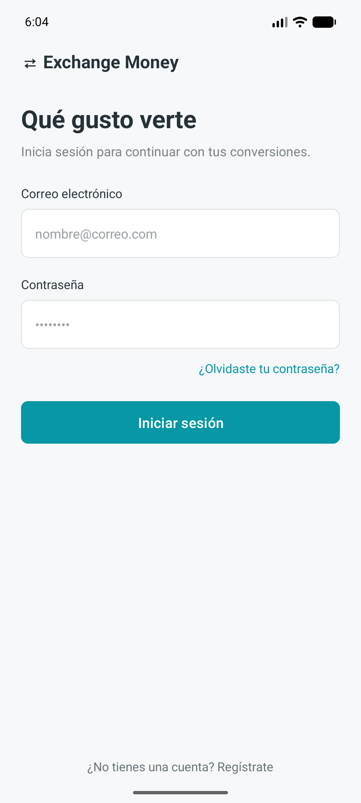
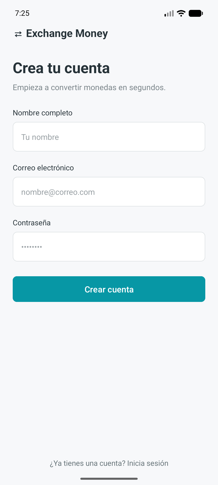
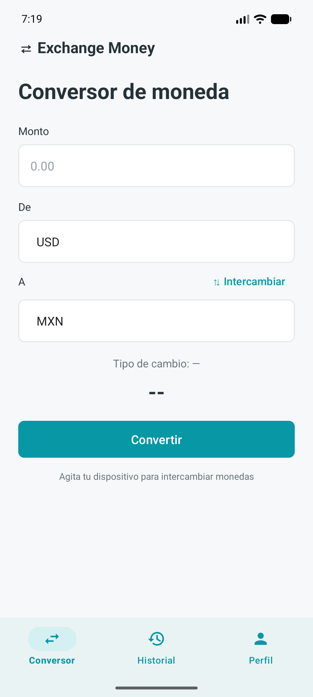
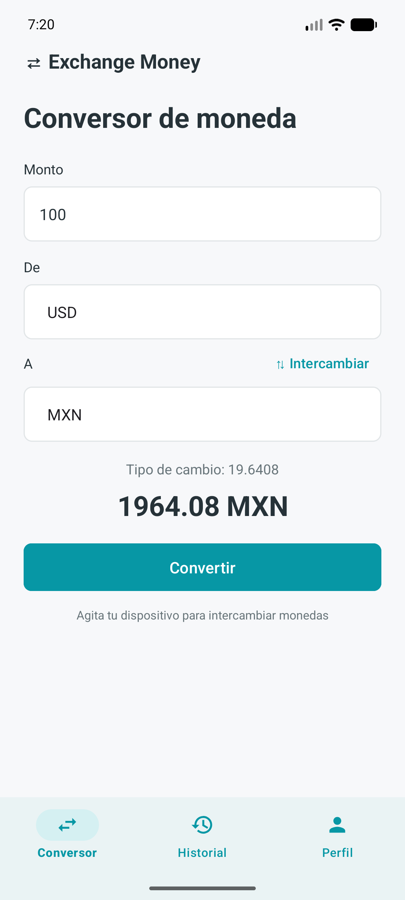
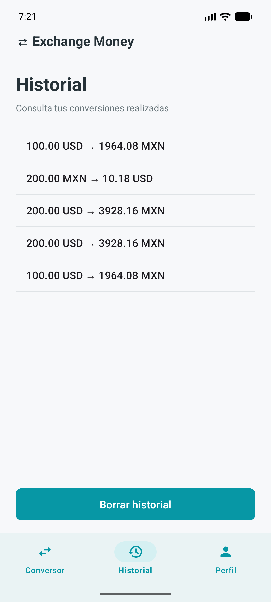
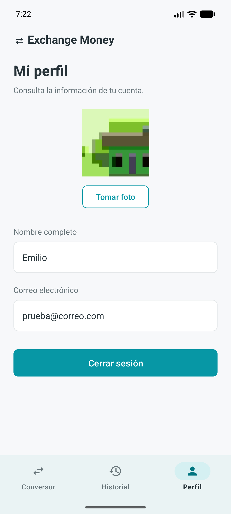
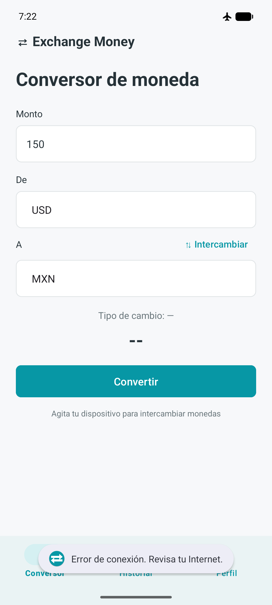
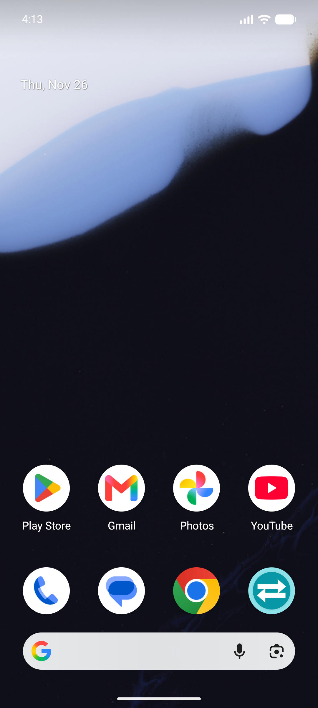
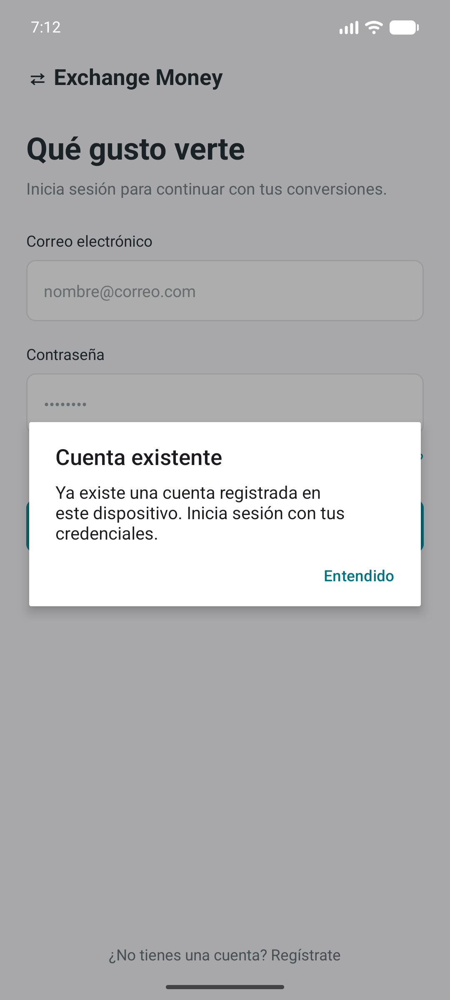

# Exchange Money

Aplicacion movil Android para la conversion de monedas mediante
la consulta de tipos de cambio a traves de una API REST.

## Descripcion

Exchange Money permite realizar conversiones de monedas,
consultar el historial de operaciones y administrar un perfil
de usuario mediante almacenamiento local.

El proyecto utiliza la arquitectura MVVM para separar
la interfaz grafica, la logica de negocio y los modelos de datos.

## Funcionalidades

- Registro e inicio de sesion.
- Validacion de credenciales.
- Persistencia de sesion.
- Conversion de monedas mediante ExchangeRate-API.
- Intercambio manual de monedas.
- Intercambio de monedas mediante el acelerometro.
- Historial persistente de conversiones.
- Eliminacion del historial.
- Perfil de usuario.
- Captura de fotografia mediante la camara.
- Almacenamiento local de fotografia.
- Indicador de carga durante las consultas.
- Manejo de errores de conexion.
- Cierre de sesion.
- Proteccion de contrasenas mediante PBKDF2.
- Navegacion inferior e iconos personalizados.

## Tecnologias utilizadas

| Tecnologia | Aplicacion |
|---|---|
| Kotlin | Lenguaje de programacion |
| XML | Interfaces graficas |
| MVVM | Arquitectura del proyecto |
| Retrofit | Consumo de servicios REST |
| Gson | Procesamiento de JSON |
| SharedPreferences | Almacenamiento local |
| LiveData | Observacion de datos |
| ViewModel | Logica de negocio |
| ViewBinding | Vinculacion de interfaces |
| Material Design | Componentes visuales |
| SensorManager | Uso del acelerometro |
| Activity Result API | Captura de fotografias |
| PBKDF2 | Proteccion de contrasenas |
| JUnit | Pruebas automatizadas |
| Android Lint | Analisis estatico |

## Arquitectura del proyecto

    exchangemoney/
    |-- api/
    |-- scene/
    |   |-- converter/
    |   |-- history/
    |   |-- login/
    |   |-- profile/
    |   |-- register/
    |-- storage/
    |-- MainActivity.kt

Cada pantalla mantiene la separacion de responsabilidades
mediante los componentes correspondientes de MVVM.

## Requisitos

- Android Studio.
- Android SDK configurado.
- Android 7.0 o superior (API 24).
- Conexion a Internet para consultar tipos de cambio.
- API Key de ExchangeRate-API.

## Configuracion

1. Clonar o descargar el repositorio.
2. Abrir el proyecto en Android Studio.
3. Sincronizar las dependencias de Gradle.
4. Obtener una API Key de ExchangeRate-API.
5. Agregar la siguiente propiedad en local.properties:

    EXCHANGE_API_KEY=TU_API_KEY

6. Seleccionar un emulador o dispositivo Android.
7. Compilar y ejecutar la aplicacion.

El archivo local.properties se encuentra excluido del
repositorio mediante .gitignore.

## Compilacion

En Windows:

    .\gradlew.bat assembleDebug

## Pruebas automatizadas

Ejecutar las pruebas unitarias:

    .\gradlew.bat testDebugUnitTest

Ejecutar las pruebas instrumentadas en un dispositivo de pruebas:

    .\gradlew.bat connectedDebugAndroidTest

Ejecutar el analisis estatico:

    .\gradlew.bat lintDebug

## Resultados de calidad

| Indicador | Resultado registrado |
|---|---|
| Pruebas unitarias | 15 aprobadas |
| Pruebas instrumentadas definitivas | 23 aprobadas |
| Total de pruebas aprobadas | 38 aprobadas |
| Pruebas propias | 36 |
| Errores de Android Lint | 0 |
| Advertencias de Android Lint | 8 |

Las pruebas instrumentadas utilizan un almacenamiento
diferenciado del almacenamiento habitual de la aplicacion.
Se recomienda ejecutarlas en un emulador dedicado.

## Seguridad

- Las contrasenas se protegen mediante PBKDF2 y salt aleatorio.
- Las credenciales no se almacenan directamente en texto plano.
- Se restringen las copias de seguridad de datos locales.
- La API Key se configura fuera del codigo fuente versionado.
- No se incluyen archivos privados ni certificados de firma.

## Limitaciones

- La autenticacion se realiza mediante almacenamiento local.
- Se admite una cuenta registrada por dispositivo.
- No existe un servicio de recuperacion de contrasena por correo.
- Las conversiones requieren conexion a Internet.
- La API Key incluida durante la compilacion puede extraerse del APK.
- La aplicacion tiene un proposito academico.

## Version

1.0

## Proyecto academico

Desarrollado como parte de un proyecto universitario
de desarrollo de aplicaciones moviles Android.

## Capturas de pantalla

### Autenticacion y conversion

| Inicio de sesion | Registro | Conversor |
|---|---|---|
|  |  |  |

### Funcionalidades principales

| Conversion realizada | Historial | Perfil |
|---|---|---|
|  |  |  |

### Seguridad y manejo de errores

| Error de conexion | Icono personalizado | Cuenta existente |
|---|---|---|
|  |  |  |
